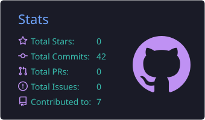
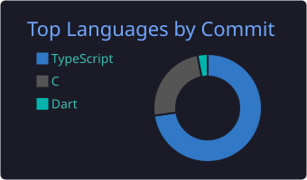
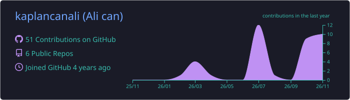

 

---

### About

I'm a computer engineer who likes owning a product from the first idea to the version people actually use. Most of my time goes into agents built on large language models, computer vision models that have to run in real time, and automations that take repetitive work off people's plates.

When an idea needs an interface, I build that part too. Usually that means Next.js on the web, Flutter on mobile, and FastAPI behind both.

### What I work on

| | |
|---|---|
| **Agents & LLMs** | Assistants and tools that complete real tasks, not just chat |
| **Computer vision** | YOLO-based detection pipelines tuned for real-time use |
| **AI for finance** | Explainable market signals and risk indicators |
| **Automation** | Workflows that replace manual, repeated steps |
| **Full-stack** | Web and mobile apps from backend to UI |

### Stack

  
  &nbsp;
  

### GitHub

<picture>
  <source media="(prefers-color-scheme: dark)" srcset="https://raw.githubusercontent.com/kaplancanali/kaplancanali/output/github-snake-dark.svg"/>
  <source media="(prefers-color-scheme: light)" srcset="https://raw.githubusercontent.com/kaplancanali/kaplancanali/output/github-snake.svg"/>
  
</picture>

